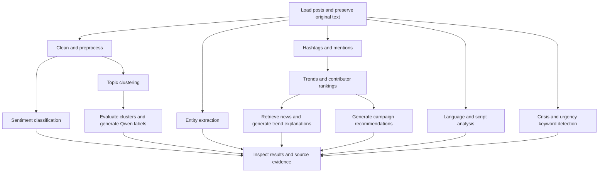

# Social Media Intelligent Platform

This project demonstrates a pipeline that transforms social media posts into insights for sentiment monitoring, topic discovery and brand campaigns. It combines traditional NLP with Qwen generation and retrieved news context. It includes a Jupyter notebook and a local Streamlit app named **Signal Desk**.

## Project structure

```text
GroupB_Assignment3/
├── README.md
├── code/
│   ├── NotebookName1.ipynb
│   └── demo/
│       ├── app.py
│       ├── common.py
│       ├── monitor.py
│       ├── pages/
│       │   ├── 1_Basic_Techniques.py
│       │   └── 2_Advanced_Techniques.py
│       ├── requirements.txt
│       ├── requirements-qwen.txt
│       └── README.md
├── presentation/
└── report/
```

## Analysis pipeline

The pipeline loads and cleans posts while preserving original text for review. Several analysis branches extract sentiment, entities, hashtags, mentions and topics. Hashtag activity supports trend analysis and contributor rankings. Selected evidence also supports news-assisted explanations and campaign recommendations.



Multilingual analysis and crisis detection can be reviewed in sequence on the same posts. Crisis detection currently selects dictionaries using its own cues rather than the language detector's predictions.

## Techniques implemented

| Area | Implementation |
|---|---|
| Preprocessing | Normalization, word splitting, stop-word removal with negation retained, and WordNet lemmatization in the notebook |
| Named Entity Recognition | spaCy extraction of people, organizations, geographic entities and facilities |
| Information extraction | Regular expressions for hashtags and mentions |
| Sentiment classification | TF-IDF with Logistic Regression and held-out classification metrics |
| Trend analysis | Daily hashtag volumes using dataset timestamps |
| Contributor identification | Author post counts for a selected hashtag |
| Notebook topic detection | TF-IDF, TruncatedSVD, normalization, KMeans and silhouette evaluation |
| Foundation model | Qwen3-0.6B for cluster labels, trend explanations and campaign briefs |
| Retrieval-augmented generation | Retrieved news headlines and matching posts supplied as generation evidence |
| Prompt engineering | Task instructions, response constraints and treatment of posts as untrusted evidence |
| Multilingual analysis | Language detection, script analysis and normalization with originals retained |
| Crisis detection | Crisis and urgency keyword matching with evidence for review |

## Dataset and sampling

The notebook uses Sentiment140. Its six original columns are `target`, `id`, `date`, `flag`, `user` and `text`. Sentiment labels are mapped from `0` and `4` to binary negative and positive labels. Update the dataset path in the loading cell to match your local CSV location.

Some stages process the entire cleaned dataset, while expensive stages use reproducible samples:

| Notebook stage | Data processed |
|---|---|
| Preprocessing and hashtag/mention extraction | Entire loaded dataset, subject to cleaning |
| Trend analysis | Cleaned posts with valid dates |
| Contributor ranking | All cleaned posts matching the selected hashtag |
| Named Entity Recognition | Up to 3,000 tweets |
| Sentiment classification | Up to 200,000 tweets, with an 80:20 train/test split |
| Topic clustering | Up to 20,000 tweets, excluding unusable vectors |
| Silhouette evaluation | The same sample of up to 2,000 clustered tweets for each candidate |
| Qwen topic labeling | Keywords and up to four example tweets per cluster |
| Separate multilingual and crisis sections | A shared sample of up to 500 tweets |

The topic model assigns topics to the clustering sample. It does not subsequently label all remaining tweets. Output previews such as `.head(10)` limit displayed rows and do not necessarily limit the analysis.

## Run the notebook

Open [code/NotebookName1.ipynb](code/NotebookName1.ipynb) in Jupyter or a notebook editor. Use a Python environment containing pandas, NumPy, scikit-learn, Matplotlib, NLTK and spaCy. Install an English spaCy model for NER. Transformer generation also requires PyTorch, Transformers and, for automatic device mapping, Accelerate. Optional `langdetect` enables language predictions beyond script fallbacks.

Update the data-loading path and run cells in order. NLTK resources and Qwen weights may require downloads. The branding chatbot requests campaign details interactively. The separate crisis section uses the sample created by the preceding multilingual section.

Topic detection compares 5, 10, 15 and 20 clusters when the data supports those counts. It selects the highest reduced-space cosine silhouette score and reports original TF-IDF separation and cluster sizes. Review keywords and source posts alongside the scores to assess topic usefulness. Qwen labels summarize the evidence but do not establish clustering quality.

## Run the Streamlit demo

From the project folder, run:

```powershell
cd code/demo
py -m venv .venv
.\.venv\Scripts\Activate.ps1
python -m pip install -r requirements.txt
python -m streamlit run app.py
```

The app normally opens at `http://localhost:8501`. Use illustrative demo posts or upload CSV, JSON or JSONL. The **Basic Techniques** and **Advanced Techniques** pages are available in the sidebar.

See the [demo README](code/demo/README.md) for supported columns, optional spaCy and Qwen installation, and feature instructions. The demo uses TF-IDF with MiniBatchKMeans for topics; the notebook's SVD and silhouette comparison has not been added to that page.

## Scope and limitations

Sentiment140 is historical. Its latest dataset date does not represent current social media activity. News retrieval adds recent context but does not prove why a historical hashtag was popular. A live platform feed requires a separate API integration or new exports.

Crisis detection is a keyword baseline, automatic translation is not implemented, and contributor counts do not measure reach. Sampling affects the scope of reported results. Generated labels, explanations and campaign suggestions require review against the supplied evidence.
